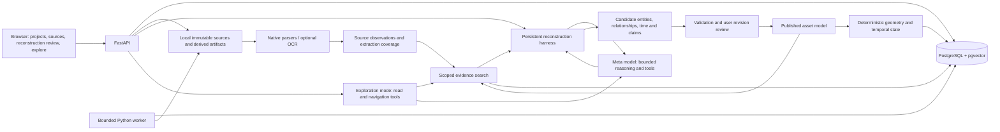

# FieldLens application architecture

Design revision: 2026-10-28. Backlog: FL-014. **Workflow/cohort baseline confirmed;
detailed implementation packets require review, committed contracts and preflight.
No application behavior has been implemented or verified.**

The initial package was integrated in `4ae7f7b`, and the project/reconstruction/
UI-first revision in `a4bf9ee`. On October 28 the owner selected F-12/F-14/F-5,
accepted generic F-12 equipment and visible discrepancies, and confirmed hybrid
categories, explicit reconstruction/review/publication and upload byte/file limits.
This supersedes the earlier unanswered clarification and cohort/planning hold.
G1 engineering qualification, live API approval and dispatch readiness remain
separate; accepting warnings does not validate their underlying measurements.

This answers the architecture request using the actual source inspection in
[equipment feasibility](EQUIPMENT_DATA_FEASIBILITY.md) and
[data discovery](VOLVE_DATA_DISCOVERY.md). Source schemas remain adapter-specific:
the canonical domain model below does not pretend that an uninspected completion
report has particular columns. Local source access is now established; unresolved
compatibility/history and extraction qualification still block affected acceptance.

The primary product is **agent-led reconstruction of composite assets within a
project**. Parsing, retrieval, deterministic engineering, 3D and charts support
that outcome; a late chatbot on a pre-authored scene would not satisfy it.

## 1. Decisions and boundaries

| Decision | Selected approach | Reason / evidence |
|---|---|---|
| Deployment | Local modular monolith: one Python API, one worker, one PostgreSQL instance, one browser | Owner-approved single-user WSL demo; minimizes services and memory |
| Project boundary | One logical source corpus, many immutable source/model revisions per project | Related files and assets stay together; batches do not create disconnected datasets |
| Engineering authority | Immutable sources -> attributed claims -> deterministic projections | Inspected drilling/completion label mismatches show why file names and model summaries cannot establish installed state |
| API | FastAPI REST `/api/v1`, OpenAPI-generated TypeScript; polling for jobs | Typed interfaces without a second Node API, websocket service or message broker |
| Persistence | PostgreSQL 17 + pgvector 0.8 release families; SQLAlchemy 2/Alembic | Relational integrity, full text, vectors and typed graph edges in one store |
| Background work | Separate Python worker sharing the same package and database | CPU-heavy work must not block async requests; persistent queue survives restarts |
| UI | React 19, TypeScript strict, Vite 8, R3F 9, Three.js/WebGL2 | Required interactive scene and linked panels; no SSR or WebGPU dependency |
| Retrieval | Exact IDs + PostgreSQL full text + local dense embeddings + typed graph expansion | Identifier precision and evidence coverage matter more than adding a graph service |
| Agent | Persistent custom Python harness with reconstruction and exploration modes, shared Meta SDK adapter and budget ledger | SDK is transport; application owns planning/tools/state/validation/recovery; development agents are separate |
| Publication | Agent stages a source-backed model/diff; user publishes only eligible results | Owner-confirmed October 28; schema validity or model confidence cannot establish engineering truth |
| Equipment | Procedural source-dimensioned primitives first; optional reviewed Blender GLB | Tubular records contain dimensions; Blender cannot establish missing installation facts |
| Data quality | Shared source/draft/model issue inspector with evidence and affected-output blocking | Owner wants real discrepancies visible; severity and generic labels never waive validation |
| Context | Source-backed seabed mesh and depth-domain formation surfaces/picks | Mandatory context, not a reservoir simulator; never interpret TWT as depth |
| Packaging | Frontend production build served by FastAPI; Compose for DB | One local URL for demo; full application containers optional |

These are technical design selections, not measured compatibility claims.
The [technical baseline](TECHNICAL_BASELINE.md) retains the environment evidence.
The [execution plan](../plan/architecture-fieldlens-1.md) defines dependency gates.
The [contracts](specs/SHARED_CONTRACTS.md) are normative for implementation once approved.
The [first detailed packets](../plan/feature-foundation-workspace-1.md) define
foundation -> projects -> upload/jobs. F-12's missing tally does not block those
synthetic-source increments. Real model/scene acceptance still uses qualified
records, measured F-14/F-5 equipment candidates and an explicitly limited F-12 view.

## 2. Runtime and data flow



1. Create/open a project. Upload files with optional categories/tags into staging;
   stream limits/hash checks and persist a source manifest/job. Return HTTP 202.
2. The worker claims a leased job, inspects signatures, chooses a registered
   format/profile and extracts values, text, page/image locators and coverage.
   Files never execute. Finalizing a source revision does not publish an asset model.
3. Inspect source content/tables and cited source chat immediately. Index raw
   observations with quality labels; an accepted graph is not a prerequisite.
4. On explicit Reconstruct, the harness pins project/source/base revisions and a
   bounded work scope. Meta chooses allowlisted evidence/proposal tools to resolve
   entities, relationships and effective-time claims; unresolved questions persist.
5. Validate candidate support, identities, units, references and time. The UI shows
   hierarchy, attributes, evidence, conflicts and revision diff before any 3D exists.
   The owner reviews/publishes eligible results; a stale base or failed validation
   cannot advance the active model pointer. Invalid proposals remain issues.
6. Compute deterministic projections from valid published claims in bounded jobs.
   Publish immutable artifact metadata transactionally; projection/index readiness
   is separate from model publication. Unknown placement remains unlocated.
7. Explore the published model in the tree, scene, charts and conversation with
   one project/revision/time context. Domain tools are shared, not reimplemented
   inside the model. New uploads/drafts never relabel old published results.

## 3. Module and repository layout

These are **planned paths**, not existing application files.

```text
pyproject.toml / uv.lock / .python-version
backend/fieldlens/
  app.py                    API composition and static frontend serving
  contracts/                shared Pydantic models and error envelopes
  projects/                 project lifecycle, membership and source metadata
  persistence/              models, repositories and transactions
  jobs/                     leases, worker entry point, cancellation
  ingestion/                format registry, safe readers, source profiles
  engineering/              units, references, surveys, proximity, temporal state
  equipment/                installed instances, catalog models, render parameters
  context/                  seabed and formation projections
  series/                   production and log queries, display decimation
  evidence/                 source access, locators, chunks
  retrieval/                exact/full-text/vector/graph search
  reconstruction/           candidate entities/edges, validation, review/publication
  assistant/                provider adapter, budget ledger, tools, orchestration
backend/migrations/         one serialized Alembic head
backend/tests/              unit, PostgreSQL integration and source-profile tests
frontend/src/
  api/                      generated types + request/error handling
  app/                      layout and shared selection
  features/{projects,upload,reconstruction,scene,equipment,history,context,production,logs,evidence,assistant}/
frontend/tests/             interaction and browser acceptance
tests/fixtures/             synthetic and redistribution-approved fixtures only
infra/compose.yaml -> compose.yaml  PostgreSQL/pgvector + test-profile browser; loopback ports only (FL-018: root file)
scripts/                    reviewed contract-export and verification commands
```

API routes orchestrate domain services; they do not contain engineering formulas.
Domain modules cannot import React/Three.js, call Meta, or issue arbitrary SQL.
Repository functions own SQL. Native parser adapters cannot publish active
revisions directly. Rendering parameters are downstream of validated claims.

## 4. Domain and persistence boundaries

| Domain | Authoritative records | Rebuildable projections |
|---|---|---|
| Project | Project, source membership, source/model revisions, job attempts | Latest-source/active-model pointers and coverage/readiness summaries |
| Evidence | Source document/blob, source record, locator, extraction run, attributed claim | Text chunks and search indexes |
| Identity | Field, well, wellbore, explicit aliases and sidetrack parent | Asset tree and search labels |
| Reconstruction | Pinned runs, candidate entities/edges/claims, support reviews and unresolved issues | Draft/base diff and validated typed asset graph |
| Spatial | Survey stations, CRS/reference metadata, source picks/points | Trajectory samples, nearest-approach result, context meshes |
| Equipment | Installed instance/configuration claims, catalog model claims | Procedural/GLB render manifest |
| History | Effective-time events, baselines, scoped observations and corrections | Perforation intervals and length/state at selected time |
| Series | Series definition, measurement points, units and acquisition/time scope | Display-decimated windows |
| Assistant | Project conversations, pinned request context, tool execution, budget reservation and usage | Validated source/model answer and action envelope |

Use typed tables, foreign keys and revision membership rather than one universal
entity-attribute-value table. Common evidence/claim envelopes accompany typed
domain rows; they do not replace type-specific constraints. SQL queries must
scope by project and source/model revision, including evidence links, jobs,
conversations, proposals and graph expansion. A project may contain multiple
fields; it is not an alias for a geological field.

Original files live outside Git and database rows. Store byte count, SHA-256 and
server-owned relative storage keys; never accept a client filesystem path as a
source identifier. Changed sources produce new revisions. Identical content
within a project is idempotent; a filename alone does not identify a correction.
One file may describe multiple entities and content categories. User/suggested
categories are routing/search hints; original content establishes the subject.
The [workspace spec](specs/PROJECT_WORKSPACE.md) defines taxonomy and batch rules.

## 5. Geometry, references and historical truth

- A model revision records its analysis horizontal CRS and separate vertical datum.
  Volve's proposed analysis CRS is WGS84 / UTM zone 31N (EPSG:32631); source
  ED50/UTM31 coordinates retain EPSG:23031. This is not a default for uploads with
  missing metadata. Approved transforms and their stated accuracy are recorded.
- Use double-precision NumPy and pyproj; reject unknown references or unavailable
  required transforms, and disable silent ballpark transformation.
- Keep vertical conversion explicit. For a verified RKB height above MSL,
  `z_msl = rkb_height_msl - tvd_rkb`. A horizontal EPSG transformation does not
  convert MSL to ellipsoidal height or resolve an unknown rig datum.
- A tested welleng adapter implements minimum curvature. Its output is compared
  with independent analytic fixtures, not merely with another call to itself.
- Store physical `(E, N, z_up)` coordinates. Rendering uses
  `(E-E0, z-z0, -(N-N0))`; the origin and axis mapping travel in the scene manifest.
  Float32 is permitted only for local display buffers.
- Closest approach uses independently resolved physical curves with an explicit
  discretization/error bound, never visible mesh vertices or sparse stations.
- Equipment radius exaggeration is an explicit display option. Missing placement
  remains an unlocated inspector item. Drilling runs and installed production
  configurations must not share an inferred installation timeline.
- Temporal queries require revision and explicit as-of selection. Use the
  [perforation specification](specs/PERFORATION_HISTORY.md); physical coverage,
  interval access and observed flow are distinct axes.

## 6. Source support and extraction selection

First-release reader families: CSV/DAT with an approved schema profile, XLSX,
LAS 2.x, WITSML 1.4.1.1 XML, and native-text PDF. Register source-specific identity,
unit, reference and event mappings only after inspection. LAS 3, arbitrary CAD,
SEG-Y/RMS simulator import and unsupported XML dialects return explicit
unsupported-format/profile results, not successful empty datasets.

Use standard CSV/ZIP readers, openpyxl read-only XLSX, lasio, defusedxml,
pypdf and pdfplumber. Preserve PDF page/table/word coordinates when available;
table extraction is not automatically trustworthy. Scanned pages remain
`ocr_required` until a separately measured OCR adapter passes the approved sample.
Docling is the selected first OCR/layout candidate, not a mandatory always-loaded
dependency. Its model/license/RSS gate precedes installation or use. MarkItDown
may assist plain-text discovery, but is not the authority for engineering tables.

The inspected F-14 scanned schematic and F-5 legacy Word report make selected
scan/image and Word extraction required pilot profiles, not optional cosmetic
improvements. Evaluate them against reviewed page/image fixtures in FL-005-C;
source browsing exposes unsupported/partial coverage until qualification.
No universal OCR/Word importer is promised.

The 54,466,467-byte F-14 report fits the approved 128 MiB/file bound.
The 211,263,929-byte EDM export remains outside it and requires an approved
streaming profile/limit if needed. Local availability is not permission to ingest
the entire release or assume simulator formats are supported.

## 7. UI composition and interaction

Project-first desktop workspace with three views:

- **Sources:** upload queue, categories, extracted content, coverage and citations.
- **Reconstruction:** explicit run/stop/continue, candidate tree/relationships,
  attribute evidence, dated configurations, issues and review/publish controls.
- **Explore:** published asset tree at left, scene in the center, inspector/
  evidence/assistant at right and production/log charts below.

The header exposes project, source/model revision, as-of selection where relevant,
processing state and context-scoped issue counts paired with coverage.
The [quality inspector](specs/DATA_QUALITY.md) opens competing values, citations and
blocked operations. It has no Accept anyway control. Generic F-12 components are
labelled and require supported identities; unknown placement stays in an unlocated
preview, not at an invented scene coordinate.
Early source chat opens evidence without requiring a model;
engineering/navigation tools appear only as their verified services become ready.
Each delivery increment has a real persisted browser walkthrough. This design is informed by the
[visual references](design/README.md), not an existing screenshot.

At 1280x720, switch side panels to accessible drawers; keep both chart families
available as tabs rather than deleting one. At 1920x1080 show both chart panels.
The asset tree provides a keyboard alternative to every selectable 3D object.
Tree, scene, chart and assistant actions dispatch one selection operation.

Use TanStack Query for server data and a small React context/reducer for selection,
panel state and pending action acknowledgments. Do not store geometry/log arrays
in that reducer. Request cancellation and context-key checks prevent stale data
appearing under a newer wellbore/date. Preserve original acquisition dates on logs.

Lazy-load R3F, ECharts and PDF.js feature boundaries. Use demand rendering outside
active interaction, shared/disposed GPU resources, reduced-motion support and
text-plus-color evidence labels. No per-frame React state updates.

## 8. Retrieval and Meta boundaries

Exact canonical IDs/validated aliases precede lexical and vector retrieval.
Use PostgreSQL `simple` text configuration plus a GIN index; preserve punctuation
in identifiers. Use exact cosine vector search first, not unmeasured HNSW.
The embedding candidate is `BAAI/bge-small-en-v1.5` (384 dimensions) via FastEmbed,
CPU-only, with model revision, license, normalization and query-prefix policy
recorded at its evaluation gate. An unavailable vector index is an explicit
degraded retrieval mode, not a passing hybrid-retrieval test.

Retrieve at most 20 lexical and 20 vector candidates, fuse with reciprocal rank
`1/(60+rank)`, then add at most 20 eligible graph neighbors within two hops.
Keep at most 10 final chunks and 12,000 context tokens. Apply project/context/revision,
entity, validation and temporal eligibility before ranking; uncertain-time claims
remain explicitly uncertain. Exact identifier hits must not broaden to siblings.

Source mode searches extracted observations with quality/coverage labels; model
mode retrieves published claims. Candidate graph output is not silently eligible
as an installed fact. This separation prevents reconstruction's bootstrap cycle.

Exploration tool allowlist: asset/evidence search, equipment facts, selected-time perforation
state, series windows, closest approach, and proposed viewer/chart/evidence
actions. Server validation checks IDs, context, arguments, outputs and citations.
Viewer actions are proposals with acknowledgment, not arbitrary scene scripts.
External equipment research requires public manufacturer/model identifiers and
its own query budget; ordinary field questions never trigger broad web search.

The [reconstruction spec](specs/ASSET_RECONSTRUCTION.md) defines proposal tools,
run states, evidence-support review and a separate 12-case gold evaluation.
The harness owns persistent evidence-dependent planning/tool execution, bounded
retries, validation and recovery. SDK calls alone do not implement an agent.
Publication is a user action, never an available model tool. No runtime swarm,
LangGraph/Pydantic AI dependency or external agent service is needed initially;
reopen that decision only on demonstrated workflow/maintenance requirements.

Use `muse-spark-1.3` Standard as the selected entitlement-test candidate.
Responses support and actual model access are gated by FL-003, not assumed from
SDK compatibility. Do not silently substitute another provider or Contributor
mode. The [Meta spec](specs/META_INTEGRATION.md) defines finite spending/retry rules.

## 9. Resource and reliability budgets

Design limits, not measurements; approval/validation occurs before execution.

| Resource | Initial limit / response |
|---|---|
| Runtime processes | One API, one worker, one DB; no Celery/Redis broker |
| Heavy computation | One parser/geometry/embedding job at a time; two numeric-library threads |
| Upload | Owner-approved 128 MiB/file, 512 MiB/batch, 200 files/batch; streaming HTTP 413; not a lifetime project cap |
| Archives | ZIP only, no nesting/symlinks/traversal/encryption; actual expanded bytes within the same batch limit |
| PDF | 500 pages/file; process batches of <=20; account for every page |
| Job | 10-minute lease with heartbeat every 10 seconds; stage deadlines and cancellation between batches; one retry only for classified transient failure |
| Memory planning | API 384 MiB + DB 768 MiB + worker 1536 MiB; target <=3 GiB measured aggregate process RSS |
| OCR | Never concurrent with embedding/indexing; stop adapter evaluation above 1536 MiB worker RSS |
| Browser | Benchmark separately from WSL server RSS; no GPU availability claim until measured |
| Interaction | Project AC-9: p95 frame <=33.3 ms/30-second orbit at 1080p; local reads p95 <=1 s/20 requests during one import |
| Meta | One active model work unit across both modes; six tool calls, four provider attempts including retry, 90-second deadline; FL-003 global ledger |

Memory figures are budgets rather than OS enforcement guarantees. Measure child
process RSS too; pause further scheduling when available WSL RAM falls below
1 GiB. Do not count twenty logical CPUs as capacity for twenty parsing workers.
Job retries use attempt fencing so an expired worker cannot publish after a
replacement owns the lease. Startup marks abandoned work interrupted and queues
only eligible retries. Never execute parsing in FastAPI `BackgroundTasks`.

## 10. Tests, gates and delivery

See [feature index](specs/README.md) for all acceptance contracts and
[execution plan](../plan/architecture-fieldlens-1.md) for the runnable sequence.
Foundation work establishes actual commands; none are claimed to exist today.

Testing layers: deterministic unit fixtures; PostgreSQL/pgvector integration;
adapter source-fixture tests; React interactions; Playwright fresh-upload
end-to-end; opt-in live Meta evaluation. Label synthetic, mirror, replay and
official-source evidence separately.

G0 workflow/cohort decisions were confirmed October 28. New detailed packets and
contract amendments still receive review before their committed execution base.
G1 remains the accepted real-data manifest; qualified early subsets do not close
the final gate. G2 remains actual Meta entitlement and credit verification.
G3 covers independent source-chat, reconstruction and exploration gold fixtures.
G4 remains submission/rights review. G5 is package,
parser, embedding and resource qualification. These are **execution and final
acceptance gates**, not promises or missing architectural decisions.

No multi-user hosting, authentication product, simulation, arbitrary-code tools,
automatic catalog privilege changes or new paid services are included. A failed
gate blocks affected slices; it does not authorize omitting a required capability.
