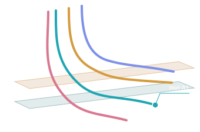
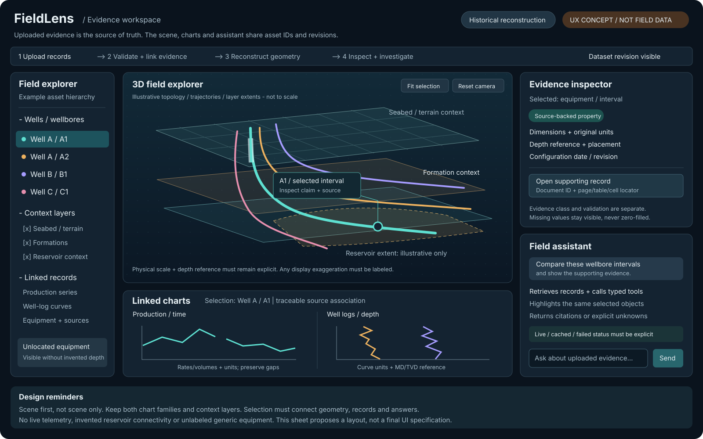
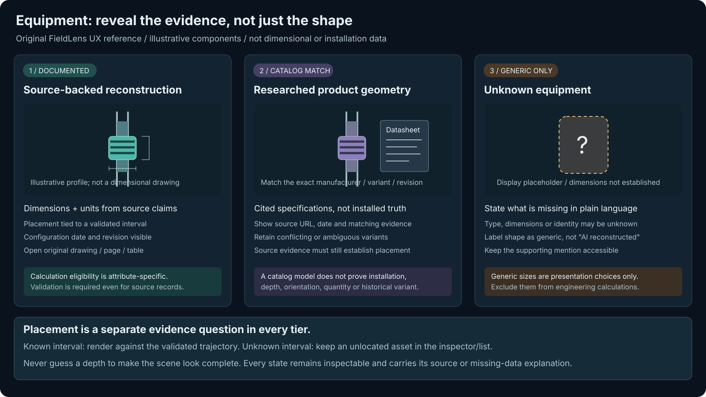

# FieldLens visual references

Reviewed 2026-10-27. These are UX reminders, not final UI specifications,
engineering diagrams, or screenshots of a working application. All locally
included geometry and chart traces are conceptual.

## Gallery

Open the [offline contact sheet](index.html) in a browser for all three images,
including a dark background for the unchanged conversation SVG.

### 1. Original conversation wireframe

[Open original SVG](assets/conversation-field-wireframe.svg).
Recovered unchanged from the inline SVG in the
[supplied ChatGPT conversation](https://chatgpt.com/share/6ae00399-28c4-83e9-b646-84ead55a2dfd),
under "What the interface might look like." Its original caption was
"Conceptual field-view wireframe, not reconstructed Volve geometry."

**Retain:** a dominant scene, distinct wellbore identities, selectable intervals,
subtle geological context, and movement from a visible object to its record.
**Do not infer:** these curves are real surveys, there are always four wells,
the planes are measured formations, or displayed proximity proves connectivity.

The SVG uses white text and a transparent background; use the contact sheet if
your Markdown viewer shows it against white. No colors, coordinates or labels
in the original file were changed.

### 2. Full evidence workspace

[Open workspace SVG](assets/fieldlens-workspace.svg).
Original FieldLens reference sheet created for this repository, expanding the
conversation wireframe into the owner's clarified full scope.

**Retain:** scene-first layout; one selection across tree/scene/charts/evidence;
visible dataset revision and depth/unit references; both chart families; all
context layers; explicit source and agent status.

**Not decided here:** exact layout, typography, colors, panel sizes, interaction
shortcuts, chart scales and mobile behavior. Those belong in an approved feature
spec and browser tests. This sheet's example data is not a usable fixture.
The 2026-10-27 perforation-history requirement additionally needs visible as-of
time/state controls and length inspection; these are not depicted in the original
sheet. Specify them against the [history contract](../specs/PERFORATION_HISTORY.md)
rather than treating the earlier illustration as a complete UI requirement.

### 3. Equipment evidence states

[Open equipment-state SVG](assets/equipment-evidence-states.svg).
Original FieldLens reference sheet for the owner's three-tier fallback policy.

**Retain:** visible evidence class, per-attribute validation, catalog/installed
distinction, generic labeling, and unlocated representation when depth is unknown.
The depicted component is a schematic placeholder, not a real product design.

## Attributed external inspiration from the conversation

These images remain **links, not vendored files**. A public search thumbnail or
an open-source viewer does not automatically license every image/document.
Copying them into the repository would require appropriate reuse rights.

| Original reference | Attribution / source | Useful lesson | Boundary |
|---|---|---|---|
| "Streamlines" | [ResInsight documentation](https://resinsight.org/3d-main-window/streamlines/) | Scene hierarchy, layered subsurface context, controlled visibility | Streamlines require simulation flow properties; FieldLens does not promise this simulation |
| "Reservoir Engineering" | Schlumberger Japan, as credited in the [conversation image gallery](https://chatgpt.com/share/6ae00399-28c4-83e9-b646-84ead55a2dfd) | Understandable spatial relationship between wells and reservoir context | Source-page URL/redistribution license not independently recovered; no copy stored |
| "Completions" and well-components illustrations | Publisher credits visible through the [conversation image gallery](https://chatgpt.com/share/6ae00399-28c4-83e9-b646-84ead55a2dfd) | Progressive field -> wellbore -> equipment detail | Not drawings of the selected Volve completion; no copied assets |
| "Comparison between standard logs (resistivity, gamma ray, spontaneous...)" | Scientific-diagram reference in the [conversation image gallery](https://chatgpt.com/share/6ae00399-28c4-83e9-b646-84ead55a2dfd) | Multiple log tracks aligned on an explicit depth reference | Paper/image rights and exact source not verified; not fixture data |

The owner approved this approach: preserve the original wireframe, retain
attributed external links, and create original local FieldLens sheets rather than
copy images with unclear rights. No expiring image-proxy URLs are embedded.

## Visual rules to carry into feature specs

- Make the field understandable before adding visual decoration.
- Keep a clear field/wellbore/equipment hierarchy without hiding related evidence.
- Distinguish source-backed, catalog-derived, interpolated and generic attributes
  with text/symbols as well as color. Validation state is a separate label.
- Show units, coordinate/depth references, revision/date and display exaggeration.
- Keep selected historical time consistent across perforation markers, interval
  state/length, chart overlays and agent questions. Preserve log acquisition dates
  and distinguish perforated/open state from wellbore production/injection/shut-in.
- Layer toggles change presentation, not the underlying engineering claims.
- Retain both production and depth-log interaction; missing data is not zero.
- Keep source navigation and keyboard-accessible asset inspection available.
- A chat answer must link to evidence and acknowledge whether a requested viewer
  action completed. Missing evidence and provider failure must be visible.
- Generic/unlocated assets are useful states, not permission to invent location.

## Provenance and reuse

| File | Origin | Local treatment |
|---|---|---|
| [conversation-field-wireframe.svg](assets/conversation-field-wireframe.svg) | Inline generated SVG from the user-supplied conversation | Exact URI-decoded bytes; copied at owner's request as conceptual material |
| [fieldlens-workspace.svg](assets/fieldlens-workspace.svg) | Original repository-authored illustration, 2026-10-27 | No third-party images, fonts, scripts or external resources |
| [equipment-evidence-states.svg](assets/equipment-evidence-states.svg) | Original repository-authored illustration, 2026-10-27 | No actual product dimensions, CAD geometry or field measurements |

The conversation SVG SHA-256 is
`7a010e7f7081adaf0c6f9a5aae73a680f65cd9674b77f1b2369249cf585af428`.
The new sheets are proposals, not adopted design-system rules. Their presence
does not establish ownership or licenses for external images mentioned above.
